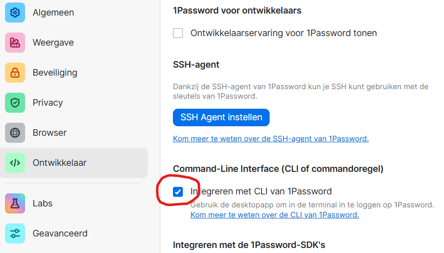

# 1Password Setup Guide

MremoteGO integrates with 1Password CLI to securely store and retrieve passwords. This allows you to:
- Keep passwords out of config files
- Share configs via git safely
- Use biometric unlock for password access

## Quick Setup

### 1. Install Requirements

```powershell
# Install 1Password desktop app (if not already installed)
# Download from https://1password.com/downloads

# Install 1Password CLI
choco install op
```

### 2. (Optional for biometrics)Enable CLI Integration

1. Open **1Password desktop app**
2. Go to **Settings → Developer**
3. Enable **"Integrate with 1Password CLI"**



### 3. Verify Setup

```powershell
# Check CLI is installed
op --version
Invoke-Expression $(op signin)

# Check integration (should show your account after desktop app authenticates)
op whoami
```

That's it! The CLI uses your 1Password desktop app session with biometric unlock.

## Using 1Password References

### In Your Config

Instead of plain text passwords, use 1Password references:

```yaml
connections:
  - name: "Production Server"
    protocol: ssh
    host: prod.example.com
    username: admin
    password: op://Private/Production Server/password
```

Reference format: `op://vault-name/item-name/field-name`

### Creating Items in 1Password

**Option 1: Use the GUI (Recommended)**
1. Click **"Store in 1Password"** checkbox when adding/editing connections
2. Select the vault
3. MremoteGO creates the item automatically and handles special characters

**Option 2: Manual**
1. Open 1Password desktop app
2. Create a new **Login** item
3. Set the title to your server name
4. Add username and password fields
5. Use format: `op://vault-name/item-title/password` in MremoteGO

**Note:** If your item name contains special characters like `()`, `[]`, or spaces, MremoteGO will automatically URL-encode them in the reference. For example:
- Item: `Server (Production)` → Reference: `op://vault/Server%20%28Production%29/password`
- The GUI handles this automatically when you use "Store in 1Password"

### Common Vaults

- `Private` - Your personal vault
- `Shared` - Team shared vault
- `DevOps` - Custom team vault

## How It Works

```
┌─────────────────────────────────────────────────┐
│ 1. User clicks "Connect" in MremoteGO          │
│    Connection has: op://Private/Server/password│
└─────────────────────────────────────────────────┘
                    ↓
┌─────────────────────────────────────────────────┐
│ 2. MremoteGO calls: op read op://...           │
│    (Hidden console window - no popup)           │
└─────────────────────────────────────────────────┘
                    ↓
┌─────────────────────────────────────────────────┐
│ 3. 1Password CLI talks to desktop app          │
│    Uses your existing session & biometric auth  │
└─────────────────────────────────────────────────┘
                    ↓
┌─────────────────────────────────────────────────┐
│ 4. Password returned to MremoteGO              │
│    - RDP: Stored in Windows Credential Manager │
│    - SSH: Passed to PuTTY with -pw flag        │
└─────────────────────────────────────────────────┘
                    ↓
┌─────────────────────────────────────────────────┐
│ 5. Connection launches with auto-login         │
└─────────────────────────────────────────────────┘
```

## Benefits

✅ **Secure** - Passwords never stored in config files  
✅ **Team Sharing** - Commit configs to git, passwords stay in 1Password  
✅ **Biometric Unlock** - Touch ID, Face ID, or Windows Hello  
✅ **No Console Windows** - All CLI calls are hidden  
✅ **Cross-Platform** - Works on Windows, Mac, Linux  
✅ **Persistent Sessions** - No repeated authentication while 1Password app is unlocked

## Troubleshooting

### "1Password CLI is not available"
- Run `op --version` to verify CLI is installed
- Make sure `op.exe` is in your PATH
- Restart terminal after installation

### "Failed to retrieve secret"
- Make sure 1Password desktop app is running and you're signed in
- Check "Integrate with 1Password CLI" is enabled (Settings → Developer)
- Verify the vault name and item name are correct
- Ensure you have access to the vault

### "Authentication required" every time
- Make sure biometric unlock is enabled in 1Password settings
- Keep 1Password desktop app running
- The app must be unlocked for CLI to work

### Wrong password retrieved
- Check the field name in your reference (usually "password")
- Verify the item title matches exactly (case-sensitive)
- Use 1Password app to view the item and confirm field names

## Advanced Usage

### Listing Vaults

```powershell
op vault list
```

### Viewing an Item

```powershell
op item get "Server Name" --vault Private
```

### Testing a Reference

```powershell
op read "op://Private/Production Server/password"
```

### Environment Variables

If using service account tokens (for automation):

```powershell
$env:OP_SERVICE_ACCOUNT_TOKEN = "ops_your_token_here"
```

See [1Password docs](https://developer.1password.com/docs/service-accounts/) for service account setup.

## Security Notes

- Config files with `op://` references are safe to commit to git
- Actual passwords never leave 1Password
- Each team member uses their own 1Password account
- Revoke vault access to remove password access
- Audit password usage through 1Password activity logs
